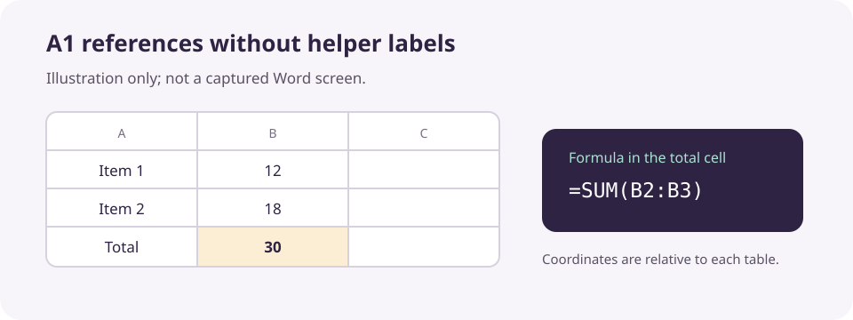

# Cellwise

Excel-style A1 formulas for tables in Microsoft Word, without helper rows or columns. Cellwise is an open-source add-in that evaluates formulas locally. **Not affiliated with or endorsed by Microsoft.**

[](https://github.com/OWNER/cellwise/actions/workflows/ci.yml)
[](https://github.com/OWNER/cellwise/releases)
[](LICENSE)
[](https://github.com/OWNER/cellwise/releases)

> **Repository setup pending:** replace `OWNER` in the badges and project metadata after the GitHub repository is created. No repository, Pages site, or public release exists yet.

## What Cellwise does

Word already supports spreadsheet-style references in its built-in formula fields, and can also insert positional formulas such as `SUM(ABOVE)` or `SUM(LEFT)`. Cellwise is a separate task-pane workflow for applying and recalculating a documented formula subset using table-relative references such as `B2`. Neither workflow requires adding visible `A`, `B`, `C` headers or `1`, `2`, `3` row labels.

- Apply formulas such as `=SUM(B2:B5)` and `=A1+B1` to the selected table cell.
- Recalculate formulas that Cellwise has stored in the table.
- Use A1-style columns beyond `Z` (`AA`, `AB`, and onward).
- Keep calculation in the add-in: there is no telemetry or document-data upload.

The drawing below is an **illustration**, not a screenshot of a live Word session. Live Word and Windows VM testing is still pending.



## Quick example

In the total cell, enter `=SUM(B2:B5)` and choose **Apply**. The first table cell is `A1`; `B2` means the second column of the second table row. Choose **Recalculate table** after changing input values.

For a step-by-step guide, see [sum a column in a Word table](site/sum-a-column.html).

## Formula reference

| Category | Supported syntax |
| --- | --- |
| Cell references and ranges | `A1`, `AA2`, `B2:B5` |
| Functions | `SUM`, `AVERAGE`, `MIN`, `MAX`, `COUNT`, `ABS`, `ROUND` |
| Operators | `+`, `-`, `*`, `/`, `^`, `%` |
| Grouping | Parentheses, for example `=(A1+B1)^2` |

This is Cellwise's own, intentionally small formula language—not full Excel compatibility. Range calculations use numeric cells; empty or non-numeric cells are skipped. A direct reference to an empty or non-numeric cell is treated as zero. See the [complete formula guide](site/excel-like-formulas.html) and [current tests](TESTING.md).

## A1 addressing rules

- The top-left cell of each table is `A1`.
- The first table row is row `1`, even when it contains column headings.
- Columns increase left to right: `A` through `Z`, then `AA`, `AB`, and so on.
- Rows increase from top to bottom: `1`, `2`, `3`, and so on.
- References are relative to the table containing the selected cell; they do not address another table or workbook.

More examples are in the [cell-reference guide](site/cell-references.html).

## Install and test

**Important:** live Word behavior has not yet been verified. The current Windows installer is a **testing prototype**, not a production deployment route.

### Build from source and sideload for testing

Prerequisites: Node.js 24 and a Word host with add-in sideloading enabled.

```powershell
npm ci
npm run build
npm run certs
npm run serve
```

Keep the local development server running. In Word, upload the development `manifest.xml` using **Insert > My Add-ins > Upload My Add-in**. Follow the [testing checklist](TESTING.md). The certificate command may require a local trust confirmation.

### Windows installer prototype

The installer requires a hosted HTTPS add-in and an **existing writable UNC network share**. It registers that share in the current user's trusted add-in catalog. Microsoft documents this network-share route for testing only and does not support it for production. The installer does not create the share or install certificates. See [installer build and test steps](INSTALLER_TESTING.md).

The unsigned installer may trigger Windows SmartScreen or unknown-publisher warnings. Signing does not guarantee that warnings disappear; reputation and local policy also matter. The project has not applied to the [SignPath Foundation](https://signpath.org/), and eligibility or acceptance is not confirmed.

### Organization deployment

An organization administrator may deploy Office add-ins through Microsoft 365 centralized deployment. That requires an eligible organization and administrator access; it is not a consumer, self-service install. No production deployment route is currently verified for this project.

There is no MSI package. MSI was deferred; see [DECISIONS.md](DECISIONS.md).

## Privacy

Cellwise reads table values through the Office.js host API and evaluates formulas in the add-in. The project contains no telemetry or code that sends document contents to a Cellwise service. The add-in's HTML and JavaScript are downloaded from the configured HTTPS host; the Office.js library is loaded from Microsoft's official Office.js URL. Internet access is needed to download hosted code, but document content is not sent to the code host by this project.

## FAQ

### How do I use Excel-style cell references in Word tables?

Place the cursor in the destination cell, enter an A1 formula such as `=A1+B1` or `=SUM(B2:B5)`, and choose **Apply**. The first cell of that table is `A1`. Word's own formula field also accepts spreadsheet-style references; Cellwise provides a separate task-pane workflow.

### How do I sum a column in a Word table?

Enter a range formula such as `=SUM(B2:B5)` in the total cell and adjust the range to include the numeric cells you want. Choose **Recalculate table** after changing the inputs. See the [sum-a-column tutorial](site/sum-a-column.html).

### Does Word already support table formulas?

Yes. Microsoft's [Word formula-field reference](https://learn.microsoft.com/en-us/office/vba/api/word.selection.insertformula) documents spreadsheet-style references and position-based forms. Cellwise is an alternative task-pane workflow with a small independent formula subset; it does not replace Word's built-in fields.

## Documentation

- [Sum a column in a Word table](site/sum-a-column.html)
- [Calculate an average in a Word table](site/averages.html)
- [Understand Word table cell references](site/cell-references.html)
- [Excel-like formulas in Word tables](site/excel-like-formulas.html)
- [Troubleshooting and tests](TESTING.md)
- [Installer test plan](INSTALLER_TESTING.md)

The documentation site is prepared for GitHub Pages but is not published. See [site build and verification](site/README.md).

## Project status

The formula engine, mock Word client tests, packaging prototype, and release workflow are present. Current automated checks and unverified items are recorded in [PROGRESS.md](PROGRESS.md), [DECISIONS.md](DECISIONS.md), and [RELEASE_CHECKLIST.md](RELEASE_CHECKLIST.md) when available.

## Roadmap

The immediate roadmap is live Word validation, a clean Windows VM install/uninstall test, and finding a supported production installation path. See the [roadmap issue draft](community/ROADMAP_ISSUE.md); no public roadmap issue exists yet.

## Contributing and support

Read [CONTRIBUTING.md](CONTRIBUTING.md) before opening a change. Bug reports and feature ideas can use the repository's issue templates after the repository is created. Until maintainers configure a private vulnerability-reporting contact, do not post security-sensitive details in a public issue; see [SECURITY.md](SECURITY.md).

## License and disclaimer

Cellwise is licensed under the [MIT License](LICENSE). Product and repository details are in [NOTICE](NOTICE).

Not affiliated with or endorsed by Microsoft.
